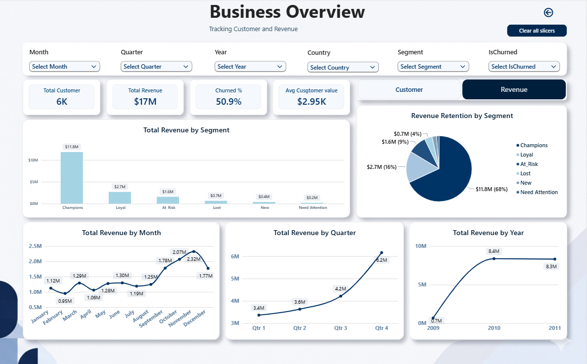
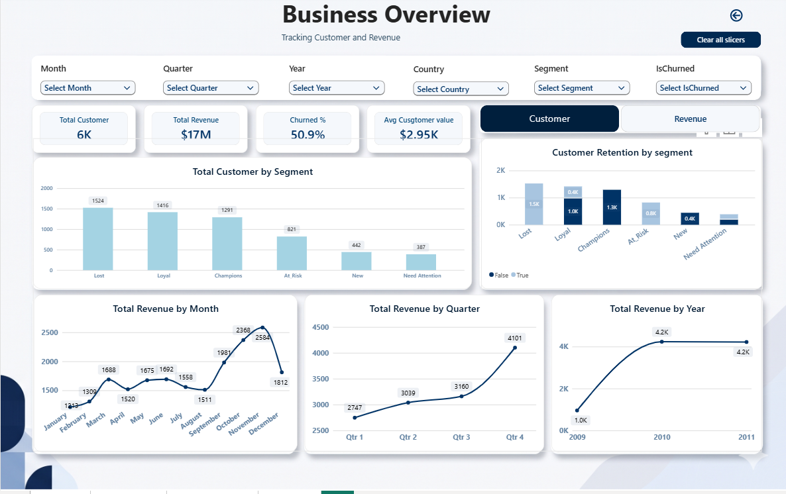

# Retail Customer RFM Analytics

## Project Overview
This project is an end-to-end data analytics solution designed to track retail sales performance and segment the customer base using RFM (Recency, Frequency, Monetary) modeling. The final deliverable is an interactive Power BI dashboard utilizing custom DAX measures, bookmark navigation, and high-transparency UI design to provide actionable insights into customer retention.

## Technical Stack
* **Python (Jupyter Notebook):** Data cleaning, missing value imputation, and RFM scoring logic using `pandas`.
* **Power BI:** Interactive data visualization, DAX calculations, page navigation, and bookmark toggling.
* **Data Architecture:** Migrated data pipeline from `.xlsx` to `.csv` to optimize memory usage and successfully bypass Power BI OLE DB driver limitations on large datasets (66MB+).

## Key Features & Insights
* **RFM Segmentation:** Built a custom Python algorithm to rank customers from 1-5 across Recency, Frequency, and Monetary metrics, successfully categorizing the user base into distinct actionable groups (Champions, Loyal, At Risk, New, Need Attention, Lost).
* **Business Performance:** Identified that the "Champions" segment drives the vast majority of revenue retention (62% / 484.3K customers), while identifying critical drop-offs in the "Need Attention" category.
* **Interactive UI:** Engineered a dual-layer dashboard using Power BI's Selection and Bookmarks panes, allowing users to seamlessly toggle between "Total Revenue" metrics and "Total Customer" metrics on a single canvas without resetting date or country slicers.

## Dashboard Previews

### Revenue View

### Customer View

